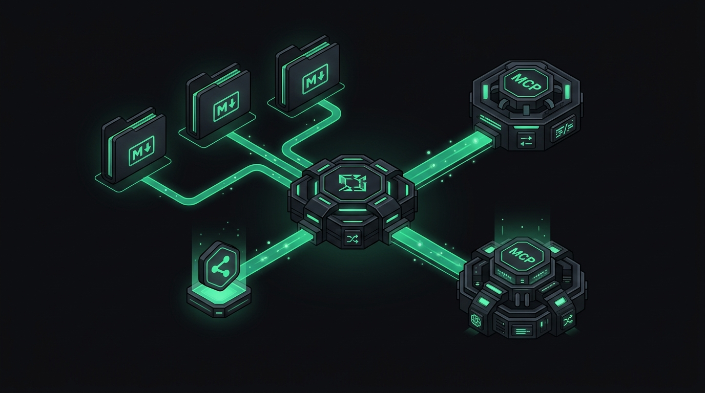

<div align="center">

# Notika

### Self-Hosted, Obsidian-Compatible Project Notes &amp; MCP Knowledge Vault

*Local-first filesystem storage (`.md` &amp; `.txt`) · Rich Normal &amp; Markdown Editor · Short Share Links &amp; Collaborator Invites · Built-in MCP Server · 100% Mobile Responsive · 10 Languages*

[](../../LICENSE)
[](../../tsconfig.json)
[](../../Cargo.toml)
[](../../server/mcp.ts)

</div>

> [!IMPORTANT]
> 🦀 **Rewritten in Rust.** Notika's backend has been rewritten from TypeScript/Express to **Rust (Axum + Tokio)**. The new server lives in `src-server/` and builds into a single binary with the React frontend embedded (`cargo build --release`). The old TypeScript server (`server/`, `server.ts`) is kept only as a reference during the migration.

---

### 🌐 Languages

[🏠 Main README](../../README.md) · [🇹🇷 Türkçe](./README.tr.md) · **🇺🇸 English** · [🇩🇪 Deutsch](./README.de.md) · [🇫🇷 Français](./README.fr.md) · [🇪🇸 Español](./README.es.md) · [🇵🇹 Português](./README.pt.md) · [🇷🇺 Русский](./README.ru.md) · [🇸🇦 العربية](./README.ar.md) · [🇯🇵 日本語](./README.ja.md) · [🇨🇳 中文](./README.zh.md)

---

<p align="center">
  
</p>

## Overview

**Notika** is a single-user, self-hostable, database-free workspace where projects map directly to folders on disk and notes map to `.md` and `.txt` files.

- **Obsidian-Compatible Filesystem:** No proprietary database; full path-traversal protection and instant local backups.
- **Normal + Markdown + Split + Preview:** Write comfortably without knowing Markdown syntax or edit raw GFM Markdown side-by-side.
- **Short Share Links & Invites (`/s/:code`):** Share individual notes via short links or named collaborator invites (`read` or `edit`).
- **Built-in MCP Server (`/api/mcp`):** Connect Claude Desktop, Cursor, and AI tools directly to read, search, create, and update notes.
- **100% Mobile Responsive & 10 Languages:** Slide-over drawer navigation, stacked mobile split view, and full i18n including RTL Arabic.

<p align="center">
  
</p>

<p align="center">
  
</p>

## 🚀 Quick Start

```bash
git clone https://github.com/your-org/notika.git
cd notika
cp .env.example .env
docker compose up -d --build
```

## 📄 License

Released under the **[MIT License](../../LICENSE)**.
