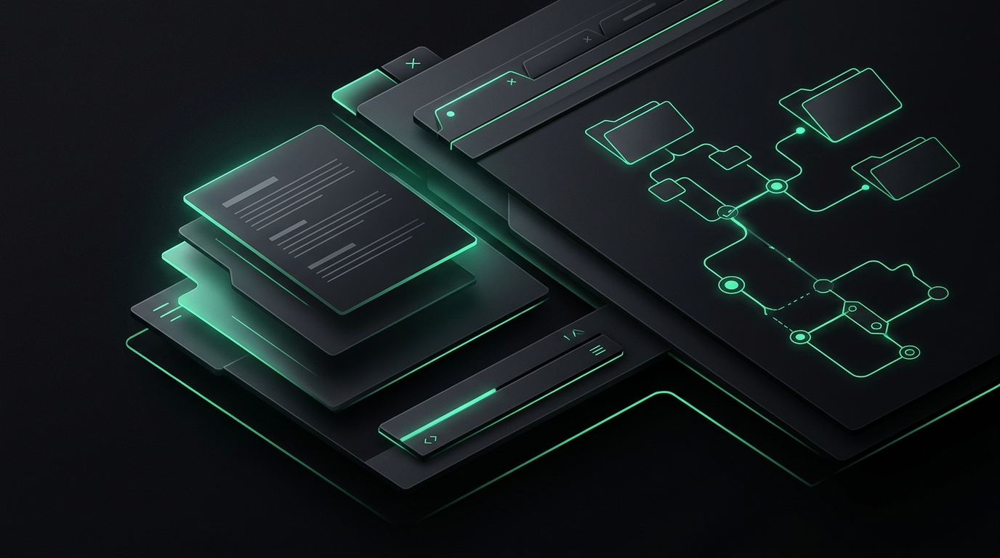

<div align="center">

# Notika

### Self-Hosted хранилище заметок проектов, совместимое с Obsidian и MCP

*Локальное файловое хранение (`.md` и `.txt`) · Обычный и Markdown-редактор · Короткие ссылки и приглашения · Встроенный MCP-сервер · 100% адаптивность · 10 языков*

[](../../LICENSE)

</div>

---

### 🌐 Языки / Languages

[🏠 Главный README](../../README.md) · [🇹🇷 Türkçe](./README.tr.md) · [🇺🇸 English](./README.en.md) · [🇩🇪 Deutsch](./README.de.md) · [🇫🇷 Français](./README.fr.md) · [🇪🇸 Español](./README.es.md) · [🇵🇹 Português](./README.pt.md) · **🇷🇺 Русский** · [🇸🇦 العربية](./README.ar.md) · [🇯🇵 日本語](./README.ja.md) · [🇨🇳 中文](./README.zh.md)

---

<p align="center">
  
</p>

## Почему Notika?

**Notika** работает без базы данных: каждый проект — это реальная папка на диске, а каждая заметка — реальный файл `.md` или `.txt` в `DATA_DIR` (`./data`), полностью совместимый с Obsidian.

- **Режимы «Обычный» и Markdown:** Визуальный WYSIWYG-редактор, поддержка `.txt`, **Markdown**, **Раздельный режим** и **Предпросмотр**.
- **Короткие ссылки и приглашения (`/s/:code`):** Делитесь заметками с правами на чтение или редактирование и приглашайте коллег.
- **Встроенный MCP-сервер (`/api/mcp`):** Подключайте Claude Desktop и Cursor напрямую к хранилищу по Bearer-токену.
- **100% мобильная версия и 10 языков:** Удобное боковое меню на телефонах и 10 языков интерфейса.

<p align="center">
  
</p>

<p align="center">
  
</p>

## 🚀 Быстрый запуск (Docker)

```bash
git clone https://github.com/your-org/notika.git
cd notika
cp .env.example .env
docker compose up -d --build
```

## 📄 Лицензия

Распространяется под **[лицензией MIT](../../LICENSE)**.
