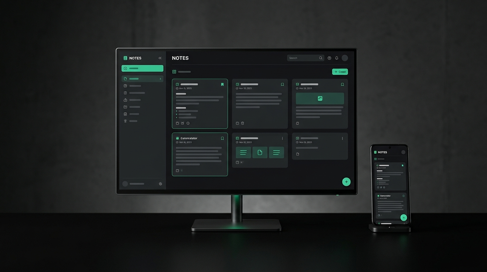

<div align="center">

# Notika

### Self-Host Edilebilir, Obsidian Uyumlu Proje Notları ve MCP Bilgi Kasası

*Yerel dosya sistemi depolaması (`.md` &amp; `.txt`) · Normal Zengin Metin ve Markdown Editörü · Kısa Paylaşım Linkleri &amp; Kişi Daveti · Dahili MCP Sunucusu · %100 Mobil Uyum · 10 Dil*

[](../../LICENSE)
[](../../tsconfig.json)
[](../../server/mcp.ts)

</div>

---

### 🌐 Diğer Diller / Languages

[🏠 Ana README](../../README.md) · **🇹🇷 Türkçe** · [🇺🇸 English](./README.en.md) · [🇩🇪 Deutsch](./README.de.md) · [🇫🇷 Français](./README.fr.md) · [🇪🇸 Español](./README.es.md) · [🇵🇹 Português](./README.pt.md) · [🇷🇺 Русский](./README.ru.md) · [🇸🇦 العربية](./README.ar.md) · [🇯🇵 日本語](./README.ja.md) · [🇨🇳 中文](./README.zh.md)

---

<p align="center">
  
</p>

## Neden Notika?

**Notika**, veritabanı bağımlılığı olmadan çalışan, her projeyi gerçek bir klasör ve her notu gerçek bir `.md` veya `.txt` dosyası olarak saklayan açık kaynaklı not ve bilgi yönetimi platformudur.

- **Veritabanı Yok — Tamamen Dosya Sistemi:** Tüm veriler `DATA_DIR` (`./data`) altında tutulur; Obsidian ve Git ile %100 uyumludur.
- **4 Yazım Modu:** Araç çubuklu **Normal** zengin metin editörü, düz `.txt` desteği, **Markdown**, **Yan Yana** (Split) ve **Önizleme** (GFM + kod renklendirme).
- **Kısa Paylaşım Linki ve Kişi Daveti (`/s/:code`):** Notları salt okunur veya düzenlenebilir kısa bağlantılarla paylaşın ya da isim/e-posta ile kişi davet edip yetkileri anında yönetin.
- **Dahili MCP Sunucusu (`/api/mcp`):** Claude Desktop, Cursor ve uyumlu yapay zeka istemcilerini Bearer anahtarıyla doğrudan kasanıza bağlayın.
- **%100 Mobil Uyum ve 10 Dil:** Telefon ve tabletlerde çekmece menü, dokunmatik uyumlu araçlar ve Arapça RTL dahil 10 dil desteği.

<p align="center">
  
</p>

<p align="center">
  
</p>

## 🚀 Hızlı Kurulum (Docker Compose)

```bash
git clone https://github.com/your-org/notika.git
cd notika
cp .env.example .env
docker compose up -d --build
```

Uygulama `http://localhost:3000` adresinde çalışacaktır.

## 🤖 MCP Bağlantı Örneği

Kenar çubuğunun altındaki **Ayarlar** menüsünden Bearer token bilginizi kopyalayın:

```json
{
  "mcpServers": {
    "notika": {
      "url": "http://localhost:3000/api/mcp",
      "headers": {
        "Authorization": "Bearer YOUR_MCP_TOKEN"
      }
    }
  }
}
```

## 📄 Lisans

Bu proje **[MIT Lisansı](../../LICENSE)** altında lisanslanmıştır.
